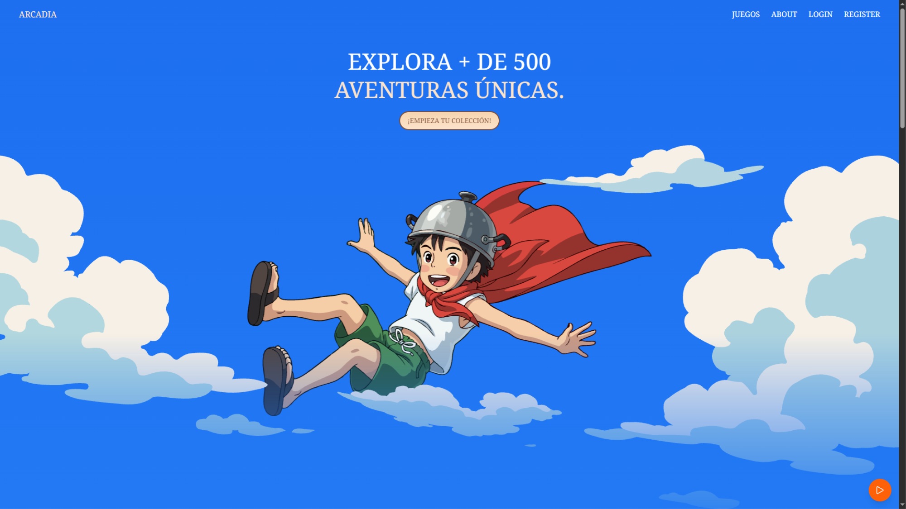
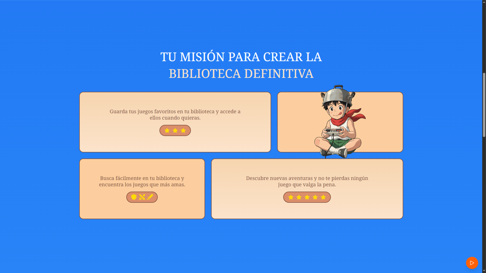
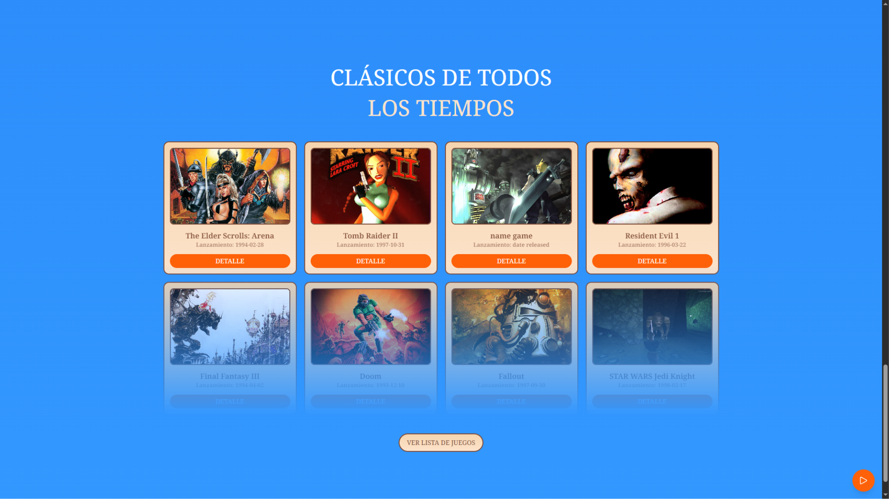
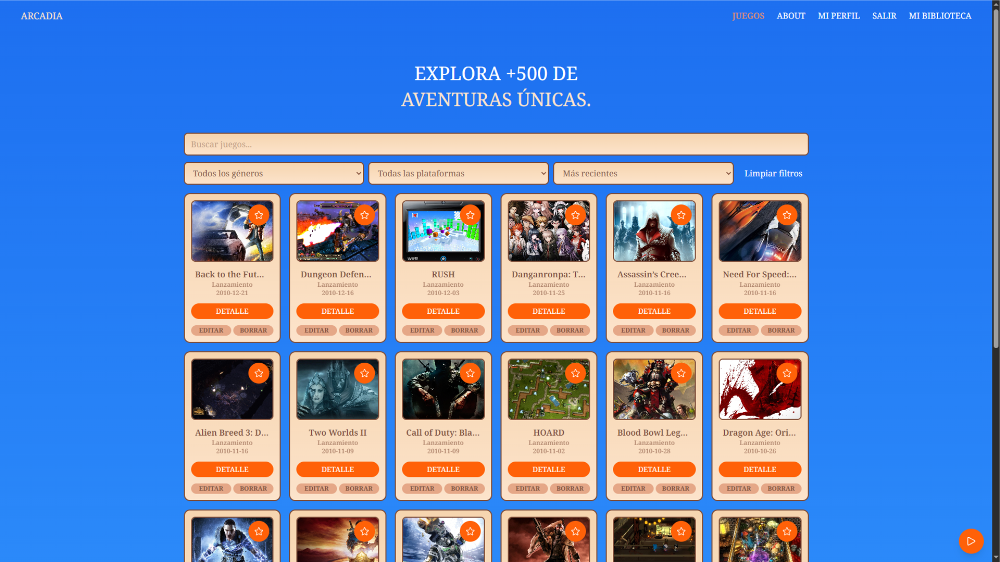
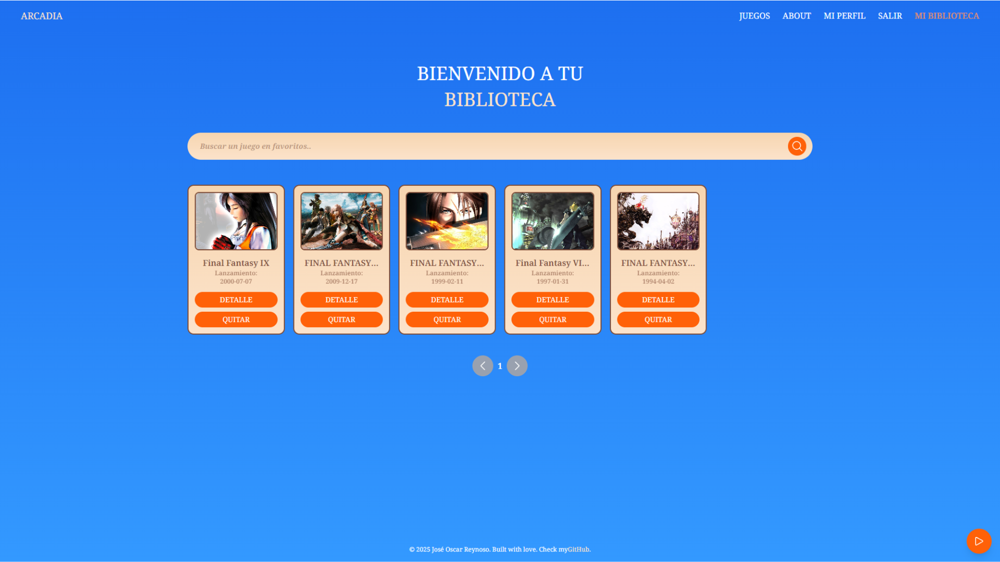
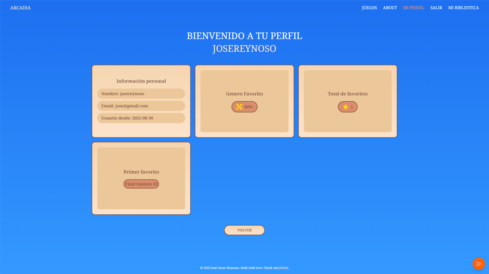
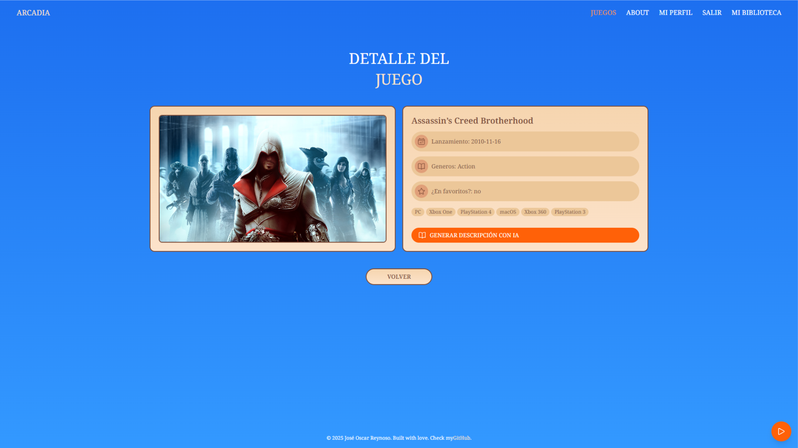

# Arcadia Frontend

Aplicación web desarrollada en **React** para la gestión de videojuegos, con autenticación por roles, CRUD de juegos, manejo de favoritos y generación de descripciones con IA.  
La app incluye distintos niveles de usuario (**user, editor, admin**) y un sistema de rutas protegidas.

---

## Tecnologías utilizadas

- **React 19 + Vite** - Framework moderno para construir interfaces rápidas y modulares.
- **Tailwind CSS v4** - Estilos responsivos con utilidades listas para usar.
- **React Context + Custom Hooks** - Manejo de estado global (auth, juegos y favoritos).
- **Axios** - Llamadas HTTP con soporte para tokens Bearer.
- **react-hook-form** - Manejo eficiente de formularios.
- **react-router-dom v7** - Rutas dinámicas y privadas.
- **framer-motion** - Animaciones fluidas para mejorar la UX.

---

## Funcionalidades principales

### Autenticación y Roles
- Login y registro de usuarios.
- **Roles con permisos específicos**:
  - **User** - Ver lista y detalle de juegos, generar descripción con IA, CRUD de favoritos.
  - **Editor** - Todo lo anterior + editar juegos.
  - **Admin** - Todo lo anterior + crear y eliminar juegos.
- Rutas protegidas según rol (PrivateRoute).

### Juegos
- Listado de juegos con **búsqueda, filtros (Nuevos/Viejos) y paginación**.
- Ver detalle de cada juego (con generación de descripción mediante IA).
- Crear, editar y eliminar juegos (según permisos).

### Favoritos
- Agregar y quitar juegos de favoritos.
- Buscar dentro de la lista de favoritos.
- Estadísticas en el perfil: cantidad de juegos, género favorito, primer favorito.

### Experiencia de Usuario
- Manejo de estados de **loading** y **error**.
- Animaciones optimizadas con **framer-motion**.
- Vistas de error personalizadas:
  - Forbidden (403) - sin permisos.
  - NotFound (404) - ruta inexistente.

---

## Capturas de pantalla

Las capturas deben colocarse en public/screenshots/ con los siguientes nombres:

### Landing Page (Home)
| Captura | Descripción |
| --- | --- |
| home-hero.png | Sección Hero con nubes y personaje |
| home-cards.png | Sección de juegos clásicos |
| home-info.png | Sección informativa |
| home-cloud.png | Sección con llamado a acción |

### Otras vistas
| Captura | Descripción |
| --- | --- |
| games-search.png | Vista principal de búsqueda y listado de juegos |
| avorites.png | Vista de lista de favoritos con buscador |
| profile.png | Vista de perfil con estadísticas |
| game-detail-ai.png | Detalle de juego con descripción generada con IA |

### Vista previa
> Las imágenes se mostrarán una vez añadidas a public/screenshots/

---

## Estructura general

- **components/** - Componentes reutilizables
- **context/** - Manejo global de auth, juegos y favoritos
- **hooks/** - Custom hooks (usePermission)
- **helper/** - Configuración de Axios e iconos
- **pages/** - Páginas principales
- **router/** - Rutas privadas y públicas
- **public/** - Assets estáticos e imágenes

---

## Instalación y uso

`ash
# Instalar dependencias
npm install

# Variables de entorno
# Copiar env-example a .env y configurar VITE_API_URL

# Desarrollo
npm run dev

# Build
npm run build

# Preview
npm run preview
`

---

## Demo en vivo

[Ver demo en vivo](https://arcadia-front.netlify.app/games)

---

## Autor

Desarrollado por [Ato](https://github.com/joreynoso) | [LinkedIn](https://www.linkedin.com/in/joreynoso/)

